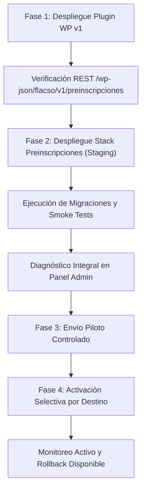

# Plan de Rollout Reversible y Despliegue a Producción

Este documento establece el procedimiento controlado, seguro y reversible para el paso a producción del nuevo Sistema de Preinscripciones de FLACSO Uruguay.

---

## 1. Principios de Despliegue Seguro

1. **Desacoplamiento Estricto**: El módulo de WordPress v1 expone la API REST sin alterar los formularios, botones ni flujos legacy existentes.
2. **Activación Granular por Destino (Canary)**: Cada cohorte o edición puede migrarse de forma independiente. Si un destino requiere volver al flujo legacy, solo se modifica el enlace en WordPress sin afectar a los demás programas.
3. **Rollback Inmediato (< 1 minuto)**: Ante cualquier inconveniente en un formulario, la restitución del enlace legacy se realiza directamente desde el editor de WordPress.
4. **Persistencia No Destructiva**: La sincronización hacia Google Sheets respeta el orden y las columnas agregadas manualmente por el equipo de coordinación.
5. **Aislamiento de Errores**: Si Google Drive o Sheets experimentan degradación externa, la solicitud queda registrada en PostgreSQL con estado explícito y trazabilidad completa.

---

## 2. Fases de Despliegue



### Fase 1: Despliegue del Módulo WordPress v1
1. **Verificar rama `main` del plugin**:
   ```bash
   cd "/home/ivan/repositorios/FLACSO Uruguay/Migrar/flacso-uruguay-plugin"
   git status
   php modules/preinscripciones/tests/run-tests.php
   ```
2. **Sincronizar a producción**:
   - Desplegar el plugin con el módulo `modules/preinscripciones/` habilitado.
3. **Verificación de no-regresión**:
   - Confirmar que los botones y enlaces públicos actuales siguen apuntando a los formularios legacy de Google Forms / Microsoft Forms.
   - Ejecutar consulta de verificación REST:
     ```bash
     curl -s https://flacso.edu.uy/wp-json/flacso/v1/preinscripciones | jq .version
     ```
   - Debe retornar `1`.

### Fase 2: Despliegue de la Aplicación en Staging
1. **Configurar `.env`**:
   - Definir credenciales de base de datos PostgreSQL, service account de Google y secret keys.
2. **Ejecutar migraciones y servicios**:
   ```bash
   docker compose up -d --build
   ./scripts/verify-production.sh http://localhost:3000
   ```
3. **Ejecutar Smoke Tests**:
   ```bash
   ./scripts/smoke-test.sh
   ```

### Fase 3: Validación en Panel Administrativo
1. Ingresar a `/admin` e iniciar sesión.
2. En la sección **Estado de Integraciones**, verificar que WordPress REST, PostgreSQL, Google Sheets y Google Drive reporten estado **Operativo**.
3. En la tabla **Formularios Detectados**, pulsar **Diagnosticar** en el programa piloto y verificar:
   - Contrato v1 válido.
   - Columnas requeridas presentes en el Google Sheet asignado.
   - Carpetas resueltas en Google Drive.
4. Realizar un envío de prueba completo con adjuntos y confirmar:
   - Nueva fila insertada en Google Sheets en las columnas correspondientes.
   - Archivo presente en Google Drive bajo `Cohorte/Documentación/`.
   - Limpieza exitosa del archivo temporal local.

### Fase 4: Activación Granular por Destino
1. Una vez aceptado el funcionamiento por el equipo académico del programa, editar la cohorte en WordPress:
   - Configurar `link_preinscripcion` apuntando a:
     `https://preinscripciones.flacso.edu.uy/targets/<id-destino>`
2. Los demás programas continúan operando con sus links legacy sin interrupción.

---

## 3. Procedimiento de Rollback de Emergencia

Si se detecta cualquier incidencia en un destino activo:

### Opción A: Rollback por Destino Individual (< 1 min)
1. Abrir el editor de la Cohorte/Edición en WordPress.
2. Reemplazar la URL en `link_preinscripcion` por el formulario legacy anterior (o dejarlo vacío para usar la configuración por defecto).
3. Guardar cambios. Los postulantes volverán inmediatamente al formulario legacy.

### Opción B: Rollback Total del Frontend
1. Si se necesita desviar todo el tráfico hacia la página institucional:
   - En Nginx o Cloudflare, redirigir `preinscripciones.flacso.edu.uy` hacia `https://flacso.edu.uy/oferta-academica`.

### Opción C: Restauración de Base de Datos
En caso de corrupción de datos técnicos o rollback de versión:
```bash
./scripts/restore-db.sh backups/flacso_preinscriptions_YYYYMMDD_HHMMSS.sql.gz
```

---

## 4. Checklist de Aceptación Pre-Lanzamiento

- [x] Contrato REST v1 implementado en WordPress con suite de pruebas PHP pasando.
- [x] Aplicación soporta cambio transparente entre fixtures y WordPress real por configuración.
- [x] Generación dinámica de formularios validada contra esquemas estrictos.
- [x] `configRevision` protege contra envíos con formularios desactualizados.
- [x] Inserción en Google Sheets por coincidencia estricta de nombres de columnas.
- [x] Archivos temporales eliminados tras 30 min de inactividad vía worker.
- [x] Subida a Google Drive organizada por cohorte y subcarpeta "Documentación".
- [x] Panel de administración y diagnóstico en vivo operativo con autenticación segura y CSRF.
- [x] Redacción automática de secretos y PII en logs y base de datos.
- [x] Rate limiting, límites de payload y cabeceras de seguridad CSP activas.
- [x] Scripts de respaldo, restauración, smoke testing y verificación de producción probados.
- [x] Suite completa de pruebas unitarias, de integración y E2E Playwright pasando.
